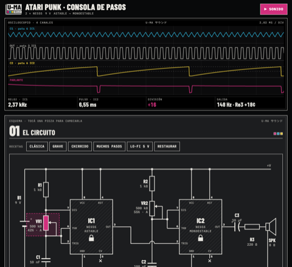

[English](README.md) · [Español](README.es.md) · [Français](README.fr.md) · **Deutsch** · [日本語](README.ja.md) · [中文](README.zh.md) · [हिन्दी](README.hi.md)

# U-MA

Instrumente und Werkzeuge zum Klangmachen, von Buenos Aires Front.

## Instrumente für norns

Jedes Instrument in maiden mit seinem `;install`-Befehl installieren und norns danach neu starten, damit die Engine kompiliert wird.

### Die Chordex-Familie

Ein Akkord pro Taste, gleiche Bedienung, in jedem eine andere Engine:

| | |
|---|---|
|  | **[Chordex 80](https://github.com/buenosairesfront/chordex80/blob/main/README.de.md)** 80er-Polysynth mit Outrun-Sonnenuntergang `;install https://github.com/buenosairesfront/chordex80` |
|  | **[Chordex FM](https://github.com/buenosairesfront/chordexfm/blob/main/README.de.md)** FM mit 4 Operatoren, als Blume gezeichnet `;install https://github.com/buenosairesfront/chordexfm` |
|  | **[ChordexSTG](https://github.com/buenosairesfront/chordexstg/blob/main/README.de.md)** Orchesterstreicher mit echter Bewegung einer gestrichenen Saite `;install https://github.com/buenosairesfront/chordexstg` |
|  | **[Chordex WT](https://github.com/buenosairesfront/chordexwt/blob/main/README.de.md)** Wavetable: 8 Bänke mit je 8 Wellen, als 3D-Tabelle gezeichnet `;install https://github.com/buenosairesfront/chordexwt` |
|  | **[Chordex CHIP](https://github.com/buenosairesfront/chordexchip/blob/main/README.de.md)** Chiptune: 8 Konsolenchips × 8 Presets, als Tracker gezeichnet `;install https://github.com/buenosairesfront/chordexchip` |
|  | **[Chordex ABNT](https://github.com/buenosairesfront/chordexabnt/blob/main/README.de.md)** Pads, Ambient, Leads und Texturen: 4 Familien × 8 Presets, mit BEWEGUNG statt Arpeggiator `;install https://github.com/buenosairesfront/chordexabnt` |

### Weitere Instrumente

| | |
|---|---|
|  | **[alto](https://github.com/buenosairesfront/alto/blob/main/README.de.md)** dreischichtiger polyphoner Synth mit polyrhythmischem 3-Ring-Sequencer; jede Seite ist ein Bild des Klangs `;install https://github.com/buenosairesfront/alto` |

## Im Browser

Nichts zu installieren: öffnen und loslegen.

| | | |
|---|---|---|
|  | **[Drum Patterns](https://buenosairesfront.github.io/drumpatterns/)** Drumcomputer-Patterns nach Stil, mit Ratchets und Export | [Code](https://github.com/buenosairesfront/drumpatterns) |
|  | **[Matriz de patcheo](https://buenosairesfront.github.io/matrizdepatcheo/)** Modularsynth im Browser mit Steckmatrix im Stil des EMS Synthi | [Code](https://github.com/buenosairesfront/matrizdepatcheo) |
|  | **[Norns Sound Creator](https://buenosairesfront.github.io/nornssoundcreator/)** Sounddesign für norns und SuperCollider; exportiert Lua, .sc, .scd, Faust (VST/AU) und Web-Apps | [Code](https://github.com/buenosairesfront/nornssoundcreator) |
|  | **[norns canvas](https://buenosairesfront.github.io/nornscanvas/)** Pixel-Editor für das norns-Display: 128×64, 16 Helligkeitsstufen | [Code](https://github.com/buenosairesfront/nornscanvas) |
|  | **[SuperCollider Lab](https://buenosairesfront.github.io/supercollider/)** SuperCollider im Browser lernen: 30 interaktive Lektionen, 10 Labs und Live-Coding | [Code](https://github.com/buenosairesfront/supercollider) |
|  | **[Laboratorio Pd](https://buenosairesfront.github.io/puredata/)** interaktiver Pure-Data-Kurs: 14 lebendige Patches, die im Browser klingen | [Code](https://github.com/buenosairesfront/puredata) |
|  | **[Una aproximación a las Síntesis](https://buenosairesfront.github.io/synthlab-2/)** ein interaktiver Rundgang durch Synthesetechniken | [Code](https://github.com/buenosairesfront/synthlab-2) |
|  | **[Gate-03](https://buenosairesfront.github.io/gate303/)** TB-303-Linie Schritt für Schritt schreiben, anhören und die Taste-für-Taste-Anleitung für die echte Maschine bekommen | [Code](https://github.com/buenosairesfront/gate303) |
|  | **[U-MA Hanon](https://buenosairesfront.github.io/hanon/)** Hanons 60 Klavierübungen mit beiden Händen auf der Tastatur, Metronom und MIDI-Analyse | [Code](https://github.com/buenosairesfront/hanon) |
|  | **[U-MA Escalas](https://buenosairesfront.github.io/escalas/)** 61 Klaviertonleitern mit Fingersätzen, Arpeggien, Harmonisierung und Progressionen | [Code](https://github.com/buenosairesfront/escalas) |
|  | **[U-MA Atari Punk](https://buenosairesfront.github.io/ataripunk/)** eine Atari Punk Console mit zwei 555 bauen: jedes Bauteil ändern, am Oszilloskop sehen und live hören | [Code](https://github.com/buenosairesfront/ataripunk) |

---

*Diese Seite wächst: Neue U-MA-Sachen kommen dazu, sobald sie erscheinen.*
