[English](README.md) · [Español](README.es.md) · **Français** · [Deutsch](README.de.md) · [日本語](README.ja.md) · [中文](README.zh.md) · [हिन्दी](README.hi.md)

# U-MA

Instruments et outils pour faire du son, par Buenos Aires Front.

## Instruments pour norns

Chacun s'installe depuis maiden avec sa commande `;install`, puis redémarrez norns pour compiler le moteur.

### La famille Chordex

Un accord par touche, les mêmes contrôles et un moteur différent pour chacun :

| | |
|---|---|
|  | **[Chordex 80](https://github.com/buenosairesfront/chordex80/blob/main/README.fr.md)** polysynthé des années 80 avec un coucher de soleil outrun `;install https://github.com/buenosairesfront/chordex80` |
|  | **[Chordex FM](https://github.com/buenosairesfront/chordexfm/blob/main/README.fr.md)** FM à 4 opérateurs, dessinée comme une fleur `;install https://github.com/buenosairesfront/chordexfm` |
|  | **[ChordexSTG](https://github.com/buenosairesfront/chordexstg/blob/main/README.fr.md)** cordes d'orchestre avec le vrai mouvement d'une corde frottée `;install https://github.com/buenosairesfront/chordexstg` |
|  | **[Chordex WT](https://github.com/buenosairesfront/chordexwt/blob/main/README.fr.md)** wavetable : 8 banques de 8 ondes, dessinée comme une table en 3D `;install https://github.com/buenosairesfront/chordexwt` |
|  | **[Chordex CHIP](https://github.com/buenosairesfront/chordexchip/blob/main/README.fr.md)** chiptune : 8 puces de console × 8 presets, dessiné comme un tracker `;install https://github.com/buenosairesfront/chordexchip` |
|  | **[Chordex ABNT](https://github.com/buenosairesfront/chordexabnt/blob/main/README.fr.md)** pads, ambient, leads et textures : 4 familles × 8 presets, avec du MOUVEMENT au lieu d'un arpégiateur `;install https://github.com/buenosairesfront/chordexabnt` |

### Autres instruments

| | |
|---|---|
|  | **[alto](https://github.com/buenosairesfront/alto/blob/main/README.fr.md)** synthé polyphonique à trois couches avec séquenceur polyrythmique à 3 anneaux ; chaque page est un dessin du son `;install https://github.com/buenosairesfront/alto` |

## Dans le navigateur

Rien à installer : ouvrez et jouez.

| | | |
|---|---|---|
| <a href="https://buenosairesfront.github.io/drumpatterns/">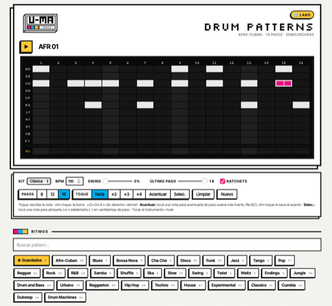</a> | **[Drum Patterns](https://buenosairesfront.github.io/drumpatterns/)** rythmes de boîte à rythmes par style, avec ratchets et export | [code](https://github.com/buenosairesfront/drumpatterns) |
| <a href="https://buenosairesfront.github.io/matrizdepatcheo/">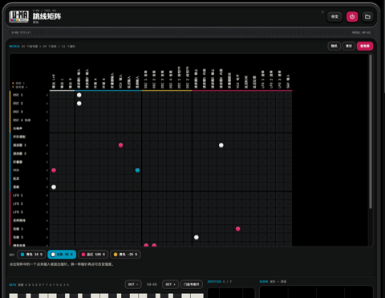</a> | **[Matriz de patcheo](https://buenosairesfront.github.io/matrizdepatcheo/)** synthé modulaire dans le navigateur avec une matrice à fiches façon EMS Synthi | [code](https://github.com/buenosairesfront/matrizdepatcheo) |
| <a href="https://buenosairesfront.github.io/nornssoundcreator/">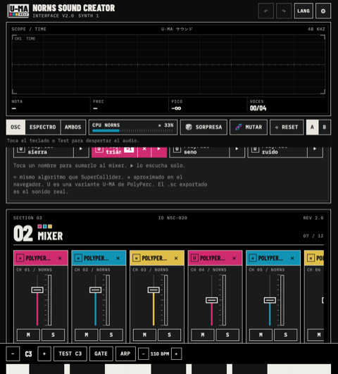</a> | **[Norns Sound Creator](https://buenosairesfront.github.io/nornssoundcreator/)** design sonore pour norns et SuperCollider ; exporte Lua, .sc, .scd, Faust (VST/AU) et web app | [code](https://github.com/buenosairesfront/nornssoundcreator) |
| <a href="https://buenosairesfront.github.io/nornscanvas/">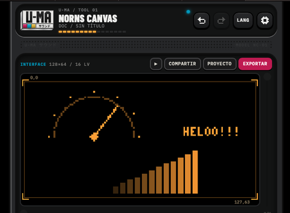</a> | **[norns canvas](https://buenosairesfront.github.io/nornscanvas/)** éditeur de pixels pour l'écran de norns : 128×64, 16 niveaux de luminosité | [code](https://github.com/buenosairesfront/nornscanvas) |
| <a href="https://buenosairesfront.github.io/supercollider/">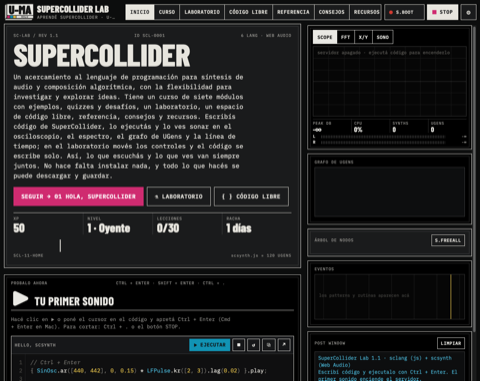</a> | **[SuperCollider Lab](https://buenosairesfront.github.io/supercollider/)** apprendre SuperCollider dans le navigateur : 30 leçons interactives, 10 labos et live coding | [code](https://github.com/buenosairesfront/supercollider) |
| <a href="https://buenosairesfront.github.io/puredata/">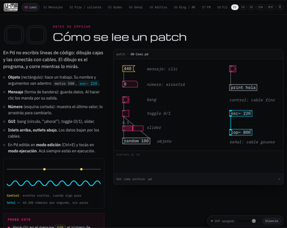</a> | **[Laboratorio Pd](https://buenosairesfront.github.io/puredata/)** cours interactif de Pure Data : 14 patches vivants qui sonnent dans le navigateur | [code](https://github.com/buenosairesfront/puredata) |
| <a href="https://buenosairesfront.github.io/synthlab-2/">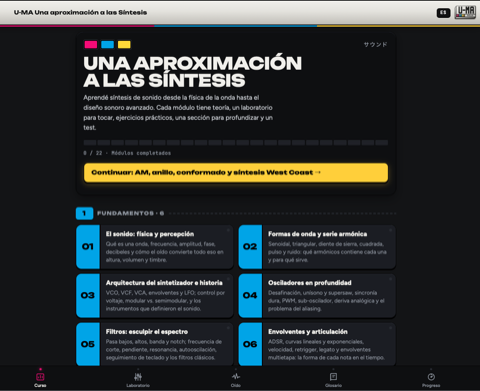</a> | **[Una aproximación a las Síntesis](https://buenosairesfront.github.io/synthlab-2/)** un parcours interactif des techniques de synthèse | [code](https://github.com/buenosairesfront/synthlab-2) |
| <a href="https://buenosairesfront.github.io/gate303/">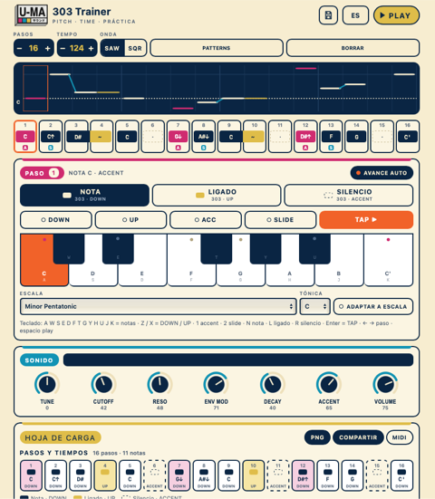</a> | **[Gate-03](https://buenosairesfront.github.io/gate303/)** écrire une ligne de TB-303 pas à pas, l'écouter et obtenir la fiche bouton par bouton pour la vraie machine | [code](https://github.com/buenosairesfront/gate303) |
| <a href="https://buenosairesfront.github.io/hanon/">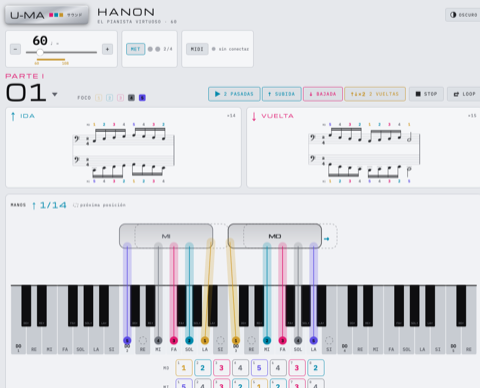</a> | **[U-MA Hanon](https://buenosairesfront.github.io/hanon/)** les 60 exercices de piano de Hanon avec les deux mains sur le clavier, métronome et analyse MIDI | [code](https://github.com/buenosairesfront/hanon) |
| <a href="https://buenosairesfront.github.io/escalas/">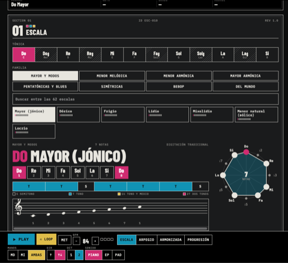</a> | **[U-MA Escalas](https://buenosairesfront.github.io/escalas/)** 61 gammes au piano avec doigtés, arpèges, harmonisation et progressions | [code](https://github.com/buenosairesfront/escalas) |
| <a href="https://buenosairesfront.github.io/ataripunk/">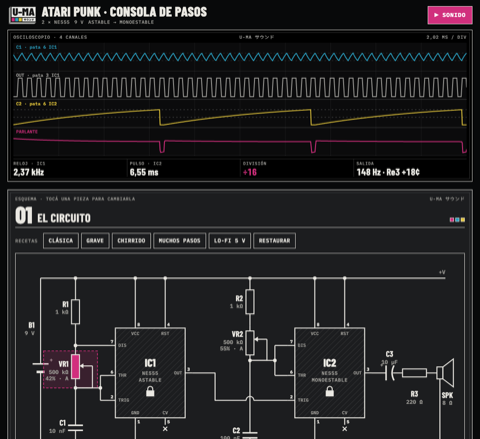</a> | **[U-MA Atari Punk](https://buenosairesfront.github.io/ataripunk/)** monter une Atari Punk Console à deux 555 : changer chaque composant, la voir à l'oscilloscope et l'écouter en direct | [code](https://github.com/buenosairesfront/ataripunk) |

---

*Cette page s'agrandit : les nouveautés U-MA s'ajoutent au fil des sorties.*
