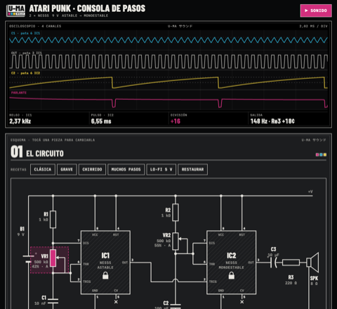

[English](README.md) · [Español](README.es.md) · [Français](README.fr.md) · [Deutsch](README.de.md) · **日本語** · [中文](README.zh.md) · [हिन्दी](README.hi.md)

# U-MA

Buenos Aires Front による、音をつくるための楽器とツール。

## norns 用の楽器

それぞれ maiden で `;install` コマンドを実行し、エンジンをコンパイルするために norns を再起動してください。

### Chordex ファミリー

1 キーで 1 コード、操作は共通、エンジンはそれぞれ別：

| | |
|---|---|
|  | **[Chordex 80](https://github.com/buenosairesfront/chordex80/blob/main/README.ja.md)** アウトランの夕焼けを描く 80 年代ポリシンセ `;install https://github.com/buenosairesfront/chordex80` |
|  | **[Chordex FM](https://github.com/buenosairesfront/chordexfm/blob/main/README.ja.md)** 花として描かれる 4 オペレーター FM `;install https://github.com/buenosairesfront/chordexfm` |
|  | **[ChordexSTG](https://github.com/buenosairesfront/chordexstg/blob/main/README.ja.md)** 弓で擦った弦の実際の動きを描くオーケストラ弦楽 `;install https://github.com/buenosairesfront/chordexstg` |
|  | **[Chordex WT](https://github.com/buenosairesfront/chordexwt/blob/main/README.ja.md)** 8 波形 × 8 バンクのウェーブテーブル。3D テーブルとして描画 `;install https://github.com/buenosairesfront/chordexwt` |
|  | **[Chordex CHIP](https://github.com/buenosairesfront/chordexchip/blob/main/README.ja.md)** チップチューン：ゲーム機チップ 8 種 × 8 プリセット、トラッカーとして描画 `;install https://github.com/buenosairesfront/chordexchip` |
|  | **[Chordex ABNT](https://github.com/buenosairesfront/chordexabnt/blob/main/README.ja.md)** パッド、アンビエント、リード、テクスチャー：4 ファミリー × 8 プリセット、アルペジエーターの代わりにムーブメント `;install https://github.com/buenosairesfront/chordexabnt` |

### そのほかの楽器

| | |
|---|---|
|  | **[alto](https://github.com/buenosairesfront/alto/blob/main/README.ja.md)** 3 リングのポリリズム・シーケンサーを備えた 3 レイヤーのポリシンセ。どのページも音の絵 `;install https://github.com/buenosairesfront/alto` |
|  | **[alan](https://github.com/buenosairesfront/alan/blob/main/README.ja.md)** 手足のひとつひとつがドローンの声になる、データでできた 3D の体。動かし、カメラで回り、粒子に崩す `;install https://github.com/buenosairesfront/alan` |

## ブラウザで

インストール不要：開いてすぐ使えます。

| | | |
|---|---|---|
|  | **[Drum Patterns](https://buenosairesfront.github.io/drumpatterns/)** スタイル別のドラムマシン・パターン。ラチェットとエクスポート付き | [コード](https://github.com/buenosairesfront/drumpatterns) |
|  | **[Matriz de patcheo](https://buenosairesfront.github.io/matrizdepatcheo/)** EMS Synthi 風のピンマトリクスを備えたブラウザ上のモジュラーシンセ | [コード](https://github.com/buenosairesfront/matrizdepatcheo) |
|  | **[Norns Sound Creator](https://buenosairesfront.github.io/nornssoundcreator/)** norns と SuperCollider の音作り。Lua、.sc、.scd、Faust（VST/AU）、Web アプリに書き出し | [コード](https://github.com/buenosairesfront/nornssoundcreator) |
|  | **[norns canvas](https://buenosairesfront.github.io/nornscanvas/)** norns 画面用のピクセルエディター：128×64、16 段階の明るさ | [コード](https://github.com/buenosairesfront/nornscanvas) |
|  | **[SuperCollider Lab](https://buenosairesfront.github.io/supercollider/)** ブラウザで SuperCollider を学ぶ：30 のレッスン、10 のラボ、ライブコーディング | [コード](https://github.com/buenosairesfront/supercollider) |
|  | **[Laboratorio Pd](https://buenosairesfront.github.io/puredata/)** Pure Data のインタラクティブ講座：ブラウザで鳴る 14 のパッチ | [コード](https://github.com/buenosairesfront/puredata) |
|  | **[Una aproximación a las Síntesis](https://buenosairesfront.github.io/synthlab-2/)** シンセシス技法をめぐるインタラクティブなツアー | [コード](https://github.com/buenosairesfront/synthlab-2) |
|  | **[Gate-03](https://buenosairesfront.github.io/gate303/)** TB-303 のラインをステップごとに書いて聴き、実機用のボタンごとの手順書を作成 | [コード](https://github.com/buenosairesfront/gate303) |
|  | **[U-MA Hanon](https://buenosairesfront.github.io/hanon/)** アノンの 60 のピアノ練習曲。鍵盤上の両手、メトロノーム、MIDI 分析つき | [コード](https://github.com/buenosairesfront/hanon) |
|  | **[U-MA Escalas](https://buenosairesfront.github.io/escalas/)** 61 のピアノ音階。運指、分散和音、ハーモナイズ、コード進行 | [コード](https://github.com/buenosairesfront/escalas) |
|  | **[U-MA Atari Punk](https://buenosairesfront.github.io/ataripunk/)** 2 つの 555 で Atari Punk Console を組む。部品を変え、オシロで見て、リアルタイムで聴く | [コード](https://github.com/buenosairesfront/ataripunk) |

---

*このページは随時更新：U-MA の新作は公開しだい追加されます。*
