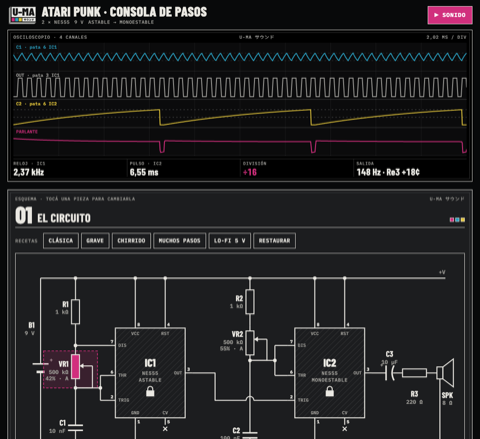
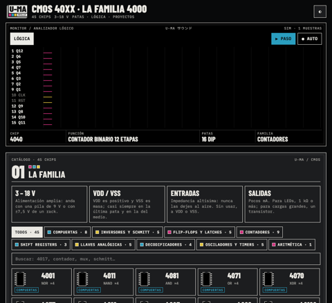

**English** · [Español](README.es.md) · [Français](README.fr.md) · [Deutsch](README.de.md) · [日本語](README.ja.md) · [中文](README.zh.md) · [हिन्दी](README.hi.md)

# U-MA

Instruments and tools for making sound, by Buenos Aires Front.

## norns instruments

Install each one from maiden with its `;install` command, then restart norns so the engine compiles.

### The Chordex family

One chord per key, same controls, a different engine in each:

| | |
|---|---|
|  | **[Chordex 80](https://github.com/buenosairesfront/chordex80)** '80s polysynth with an outrun sunset `;install https://github.com/buenosairesfront/chordex80` |
|  | **[Chordex FM](https://github.com/buenosairesfront/chordexfm)** 4-operator FM, drawn as a flower `;install https://github.com/buenosairesfront/chordexfm` |
|  | **[ChordexSTG](https://github.com/buenosairesfront/chordexstg)** orchestral strings with real bowed-string motion `;install https://github.com/buenosairesfront/chordexstg` |
|  | **[Chordex WT](https://github.com/buenosairesfront/chordexwt)** wavetable: 8 banks of 8 waves, drawn as a 3D table `;install https://github.com/buenosairesfront/chordexwt` |
|  | **[Chordex CHIP](https://github.com/buenosairesfront/chordexchip)** chiptune: 8 console chips × 8 presets, drawn as a tracker `;install https://github.com/buenosairesfront/chordexchip` |
|  | **[Chordex ABNT](https://github.com/buenosairesfront/chordexabnt)** pads, ambient, leads and textures: 4 families × 8 presets, with MOTION instead of an arpeggiator `;install https://github.com/buenosairesfront/chordexabnt` |

### More instruments

| | |
|---|---|
|  | **[alto](https://github.com/buenosairesfront/alto)** three-layer polyphonic synth with a 3-ring polyrhythmic sequencer; every page is a picture of the sound `;install https://github.com/buenosairesfront/alto` |
|  | **[alan](https://github.com/buenosairesfront/alan)** a 3D body made of data where every limb is a drone voice: move it, orbit the camera and dissolve it into particles `;install https://github.com/buenosairesfront/alan` |

## In the browser

Nothing to install: open them and play.

| | | |
|---|---|---|
|  | **[Drum Patterns](https://buenosairesfront.github.io/drumpatterns/)** drum-machine patterns by style, with ratchets and export | [code](https://github.com/buenosairesfront/drumpatterns) |
|  | **[Matriz de patcheo](https://buenosairesfront.github.io/matrizdepatcheo/)** modular synth in the browser with an EMS Synthi-style pin matrix | [code](https://github.com/buenosairesfront/matrizdepatcheo) |
|  | **[Norns Sound Creator](https://buenosairesfront.github.io/nornssoundcreator/)** sound design for norns and SuperCollider, exporting Lua, .sc, .scd, Faust (VST/AU) and web apps | [code](https://github.com/buenosairesfront/nornssoundcreator) |
|  | **[norns canvas](https://buenosairesfront.github.io/nornscanvas/)** pixel editor for the norns screen: 128×64, 16 brightness levels | [code](https://github.com/buenosairesfront/nornscanvas) |
|  | **[SuperCollider Lab](https://buenosairesfront.github.io/supercollider/)** learn SuperCollider in the browser: 30 interactive lessons, 10 labs and live coding | [code](https://github.com/buenosairesfront/supercollider) |
|  | **[Laboratorio Pd](https://buenosairesfront.github.io/puredata/)** interactive Pure Data course: 14 live patches that play in the browser | [code](https://github.com/buenosairesfront/puredata) |
|  | **[Una aproximación a las Síntesis](https://buenosairesfront.github.io/synthlab-2/)** an interactive tour of synthesis techniques | [code](https://github.com/buenosairesfront/synthlab-2) |
|  | **[Gate-03](https://buenosairesfront.github.io/gate303/)** write a TB-303 line step by step, hear it, and get the button-by-button sheet for the real machine | [code](https://github.com/buenosairesfront/gate303) |
|  | **[U-MA Hanon](https://buenosairesfront.github.io/hanon/)** Hanon's 60 piano exercises with both hands on the keyboard, metronome and MIDI analysis | [code](https://github.com/buenosairesfront/hanon) |
|  | **[U-MA Escalas](https://buenosairesfront.github.io/escalas/)** 61 piano scales with fingerings, arpeggios, harmonisation and progressions | [code](https://github.com/buenosairesfront/escalas) |
|  | **[U-MA Atari Punk](https://buenosairesfront.github.io/ataripunk/)** build an Atari Punk Console with two 555s: change every part, watch it on a scope and hear it live | [code](https://github.com/buenosairesfront/ataripunk) |
|  | **[U-MA CMOS 40XX](https://buenosairesfront.github.io/ic4040/)** the CMOS 4000 family, 45 chips: pinouts, how they work, live logic simulation, relations and a sound project for each | [code](https://github.com/buenosairesfront/ic4040) |

---

*This page keeps growing: new U-MA things are added as they come out.*
