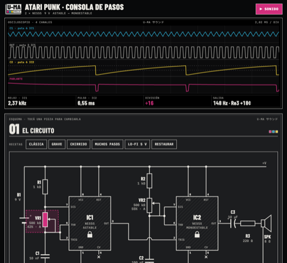

[English](README.md) · [Español](README.es.md) · [Français](README.fr.md) · [Deutsch](README.de.md) · [日本語](README.ja.md) · **中文** · [हिन्दी](README.hi.md)

# U-MA

Buenos Aires Front 出品的声音创作乐器与工具。

## norns 乐器

在 maiden 中运行各自的 `;install` 命令，然后重启 norns 以编译引擎。

### Chordex 系列

一键一和弦，操作相同，每款引擎各不相同：

| | |
|---|---|
|  | **[Chordex 80](https://github.com/buenosairesfront/chordex80/blob/main/README.zh.md)** 80 年代复音合成器，配 outrun 日落画面 `;install https://github.com/buenosairesfront/chordex80` |
|  | **[Chordex FM](https://github.com/buenosairesfront/chordexfm/blob/main/README.zh.md)** 4 算子 FM，画成一朵花 `;install https://github.com/buenosairesfront/chordexfm` |
|  | **[ChordexSTG](https://github.com/buenosairesfront/chordexstg/blob/main/README.zh.md)** 管弦乐弦乐，呈现真实的拉弦运动 `;install https://github.com/buenosairesfront/chordexstg` |
|  | **[Chordex WT](https://github.com/buenosairesfront/chordexwt/blob/main/README.zh.md)** 波表：8 个库、每库 8 个波形，画成 3D 波表 `;install https://github.com/buenosairesfront/chordexwt` |
|  | **[Chordex CHIP](https://github.com/buenosairesfront/chordexchip/blob/main/README.zh.md)** 芯片音乐：8 种游戏机芯片 × 8 个预设，画成 tracker `;install https://github.com/buenosairesfront/chordexchip` |
|  | **[Chordex ABNT](https://github.com/buenosairesfront/chordexabnt/blob/main/README.zh.md)** 铺底、氛围、主奏和纹理：4 个系列 × 8 个预设，用“运动”取代琶音器 `;install https://github.com/buenosairesfront/chordexabnt` |

### 更多乐器

| | |
|---|---|
|  | **[alto](https://github.com/buenosairesfront/alto/blob/main/README.zh.md)** 三层复音合成器，配 3 环复节奏音序器；每一页都是声音的图像 `;install https://github.com/buenosairesfront/alto` |
|  | **[alan](https://github.com/buenosairesfront/alan/blob/main/README.zh.md)** 由数据构成的 3D 身体，每个部位都是一个持续音声部：移动它、环绕摄像机、把它解体成粒子 `;install https://github.com/buenosairesfront/alan` |

## 浏览器中使用

无需安装：打开即可使用。

| | | |
|---|---|---|
|  | **[Drum Patterns](https://buenosairesfront.github.io/drumpatterns/)** 按风格分类的鼓机节奏型，支持 ratchet 和导出 | [代码](https://github.com/buenosairesfront/drumpatterns) |
|  | **[Matriz de patcheo](https://buenosairesfront.github.io/matrizdepatcheo/)** 浏览器中的模块合成器，配 EMS Synthi 风格的插针矩阵 | [代码](https://github.com/buenosairesfront/matrizdepatcheo) |
|  | **[Norns Sound Creator](https://buenosairesfront.github.io/nornssoundcreator/)** 为 norns 和 SuperCollider 设计声音，可导出 Lua、.sc、.scd、Faust（VST/AU）和网页应用 | [代码](https://github.com/buenosairesfront/nornssoundcreator) |
|  | **[norns canvas](https://buenosairesfront.github.io/nornscanvas/)** norns 屏幕的像素编辑器：128×64，16 级亮度 | [代码](https://github.com/buenosairesfront/nornscanvas) |
|  | **[SuperCollider Lab](https://buenosairesfront.github.io/supercollider/)** 在浏览器中学习 SuperCollider：30 节互动课程、10 个实验和现场编程 | [代码](https://github.com/buenosairesfront/supercollider) |
|  | **[Laboratorio Pd](https://buenosairesfront.github.io/puredata/)** Pure Data 互动课程：14 个可在浏览器中发声的实时 patch | [代码](https://github.com/buenosairesfront/puredata) |
|  | **[Una aproximación a las Síntesis](https://buenosairesfront.github.io/synthlab-2/)** 合成技术的互动导览 | [代码](https://github.com/buenosairesfront/synthlab-2) |
|  | **[Gate-03](https://buenosairesfront.github.io/gate303/)** 逐步写出 TB-303 旋律线并试听，生成真机逐键输入单 | [代码](https://github.com/buenosairesfront/gate303) |
|  | **[U-MA Hanon](https://buenosairesfront.github.io/hanon/)** 哈农 60 首钢琴练习：键盘上的双手、节拍器和 MIDI 分析 | [代码](https://github.com/buenosairesfront/hanon) |
|  | **[U-MA Escalas](https://buenosairesfront.github.io/escalas/)** 61 种钢琴音阶，含指法、琶音、和声化与和弦进行 | [代码](https://github.com/buenosairesfront/escalas) |
|  | **[U-MA Atari Punk](https://buenosairesfront.github.io/ataripunk/)** 用两颗 555 搭建 Atari Punk Console：更换每个元件，在示波器上观察并实时试听 | [代码](https://github.com/buenosairesfront/ataripunk) |

---

*本页持续更新：U-MA 的新作品发布后会陆续加入。*
